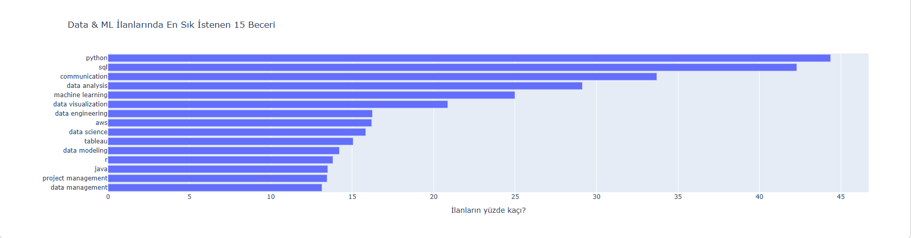
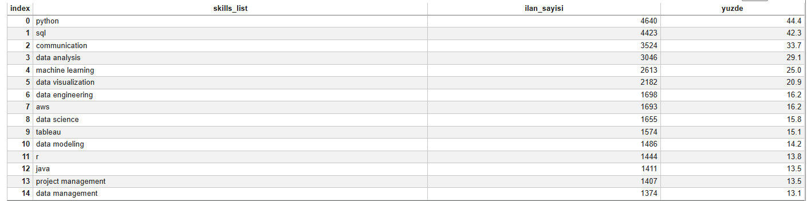

# Data & ML İş İlanlarında En Çok Aranan Beceriler

Data & ML ilanlarında hangi becerilerin kaçta kaçında geçtiğini inceleyen
veri analizim. (Short English summary: I analyzed which skills appear
most often in ~10,000 data/ML job postings from January 2024.)

## Soru
Data & ML ilanlarında en sık istenen 15 beceri hangisi?

## Veri
Kaggle:https://www.kaggle.com/datasets/asaniczka/data-science-job-postings-and-skills

## Yöntem
- Üç tablo `job_link` ile birleştirildi (12.217 ilan).
- İlanlar başlık anahtar sözcükleriyle etiketlendi, örneklemeyle elle
  kontrol edildi (örnek: "MLS" tıpta ve yazılımda farklı anlama geliyor).
- `communication` ve `communication skills` yazımları birleştirildi.
- Tekrarlı ilanlar sonucu değiştirmedi (12.217 → 12.213 satır).

## Bulgular

- Python (%44,4) ve SQL (%42,3) açık ara önde.
- İletişim (%33,7) üçüncü sırada, yani ilk üçteki tek teknik olmayan beceri.
- Yüzdeler beceri listesi dolu 10.457 Data & ML ilanına göre hesaplandı.

## Notebook
https://www.kaggle.com/code/kranylmaz/data-ml-lanlar-nda-en-ok-aranan-beceriler
